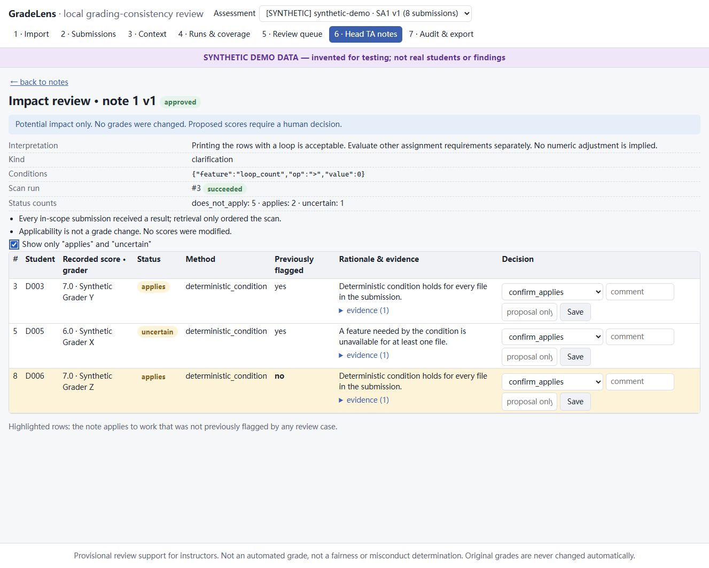

# GradeLens P0: review results and run guide

Reviewed 2026-10-31. This is a local grading-consistency review prototype.
The head TA can perform the instructor-review role. It does not assign or
change official grades, establish demographic fairness, or measure grader bias.

## What is built

The browser UI is React + TypeScript + Vite. A Python FastAPI backend serves
the built UI and API. SQLAlchemy/SQLite store imports, summaries, comparisons,
jobs, notes and decisions. A custom persistent job worker runs the pipeline;
the application does not use LangGraph or require an MCP server. Ollama serves
the local models. Claude Code wrote the application; it is not needed to run it.

1. **Import:** map leading student IDs in the CSV and submission filenames.
   Ignore suffixes such as `logo` and `mystery` for matching and comparison.
   Keep multiple files as one student bundle and record missing files/parse issues.
2. **Static extraction:** read source and extract syntax/structure facts.
   Student programs are never executed.
3. **Analyst:** the local model summarizes each distinct source file and cites
   supporting source text. Invalid quotes are rejected. A valid quote proves
   provenance, not that the model's interpretation is correct.
4. **Hybrid retrieval:** combine exact matching, lexical similarity, AST
   structure, source vectors and validated-summary vectors. Rank candidate
   pairs; only the configured pair budget reaches the reviewer.
5. **Reviewer:** read both original submissions, analyst evidence, assignment
   context and applicable approved guidance. Produce a provisional relation,
   evidence, alternatives and a question for human review. Scores and grader
   labels are withheld from model judgments; score differences help organize
   the human review queue.
6. **Head-TA review:** inspect source, resolve ambiguous expectations and
   approve a versioned interpretation with scope and exceptions.
7. **Impact scan:** evaluate the approved note against every imported
   submission in scope, including work outside the initial pilot. Use a
   deterministic condition when sufficient; otherwise use the reviewer or
   leave the result uncertain for human review. Applicability is not a score.
8. **Export:** retain original scores, human decisions and current proposals
   in a moderation report. Conflicting current proposals require reconciliation.

The analyst and reviewer currently use the same 4B model in separate calls;
they are not independent models or a trained grading ensemble. Nothing is
fine-tuned by approving a note: guidance becomes versioned context and triggers
a new scan.

## Bugs fixed during this review

| Problem | Change |
|---|---|
| Editing context left old judgments current | Invalidate dependent comparisons, cases and applicability; preserve history. Prevent edits during active analysis. |
| Unsupported equivalence survived citation rejection | Require validated support from both submissions and sufficient coverage; otherwise downgrade to insufficient evidence. |
| Scope and exceptions could be omitted or bypassed | Include them in guidance prompts; do not let a simple condition bypass free-text restrictions. |
| Future policy could influence historical comparisons | Exclude prospective policy from the historical review standard. |
| Failed impact checks could look complete and never retry | Mark failures, keep the run partial and retry failed rows on resume. |
| Model changes could reuse obsolete generated evidence | Include generation settings and local model digest in cache identity. |
| Resume could mix old candidates with changed inputs | Record an analysis input signature and require a new run when it changes. |
| Zero review budget became the default budget | Preserve an explicit zero. |
| Embedding work could hold SQLite writes across model calls | Commit per item so UI writes can proceed between calls. |
| Export could publish stale or conflicting proposals | Use current applicable decisions; leave conflicts unresolved; sanitize and uniquify filenames. |
| Assessment switching retained a case selection | Reset screen state and selected case when changing assessments. |

Also added a review-queue run filter and saved data-quality report access on
the Submissions screen. Added 14 regression test cases; the first 11 reproduced
failures before the fixes.

## What was verified

- Full backend suite: **59 passed** (48.48 seconds on this machine).
- Frontend: TypeScript check and Vite production build passed.
- Manual browser: synthetic run, run filter, source/evidence inspection,
  decision save, head-TA note approval, impact scan and moderation export.
- Synthetic impact scan: all 8 imported submissions received results;
  2 applied, 5 did not, 1 was uncertain. D006 applied despite never being
  flagged in the initial pilot. Export contained 9 gradebook rows, including
  the fixture student without a submission.
- Fresh local inference: 2 real submissions, 2 analyst summaries, source and
  summary embeddings, 1 candidate pair reviewed, no failed stage. This was a
  new smoke test, separate from the earlier reported 12-student pilot.
- No browser console warnings/errors were reported during the walkthrough.
- Original CSV SHA-256 remained
  `973f79bd3d721a7dfaab0af6907f82b05e43f603153c9d6b935ae9d20bd24a2c`.

All review runs used the separate ignored directory
`data/private/codex-review/`, on temporary port 8011. They did not populate the
normal application database. No student grades were changed, cloud calls
enabled, or Git commits created.

These checks verify software behavior. They do not measure real grading
accuracy, retrieval recall or whether any TA graded unfairly.

## Start the application

Open PowerShell in the project directory:

```powershell
# Open PowerShell in the repository root first.
.\start-gradelens.cmd
```

Keep that window open. Open **http://127.0.0.1:8000** in a browser. Use Ctrl+C
in PowerShell to stop. If port 8000 is already occupied, use
`.\start-gradelens.cmd -Port 8100` and open port 8100 instead.

Setup has already been completed on this machine. Run
`.\setup-gradelens.cmd` only for a fresh setup or to reinstall/build the
documented dependencies. You do not need to keep Claude Code running.

Ollama must be running for real inference. Check from any PowerShell window:

```powershell
ollama list
```

Both required models were present during this review. Only if absent, run:

```powershell
ollama pull qwen3.5:4b-q4_K_M
ollama pull qwen3-embedding:0.6b
```

If the Ollama desktop application is not serving, start it. Alternatively run
`ollama serve` in another terminal; do not start a second server if one is
already listening on port 11434.

To label your local audit actions, optionally set `ACTOR_NAME=head-ta` in
`.env` and restart GradeLens. This is a display/audit label, not authentication.

## First test: a predictable synthetic walkthrough

1. On **Import**, click **Load SYNTHETIC demo dataset**. Check the selected
   assessment and synthetic banner.
2. On **Runs & coverage**, select the **mock** provider for this synthetic
   test. Select D001, D002, D003, D004, D005, D007 and D008. Exclude D006 so you
   can demonstrate discovering unflagged work later. Use budget 30 and start.
3. Wait for completion. On **Review queue**, use the run filter, open
   D001/D003 and inspect the original source, evidence and alternative method.
   Save a decision requesting clarification.
4. Create a head-TA note from that case. Approve a **clarification** with:
   "Printing the rows with a loop is acceptable. Evaluate other assignment
   requirements separately. No numeric adjustment is implied."
5. For this synthetic demonstration, leave component/requirement scope and
   exceptions empty; set applicability conditions to:

   ```json
   {"feature":"loop_count","op":">","value":0}
   ```

   This identifies loop use; it does not prove complete assignment correctness.
   Choose mock scan providers and approve the note.
6. Open impact review. Expect D003 and **D006** to apply; D006 should say
   **Previously flagged: no**. D005 should remain uncertain because its
   anonymization damage prevents extraction of the needed feature.
7. Open **Audit & export** and export the moderation report. Inspect original
   scores and saved decisions. No score should change merely from approval.



## Second test: your actual SA1 data

1. On **Import**, preview the configured CSV and SA1 folder, inspect mapping
   and warnings, then commit. The reviewed snapshot had 92 gradebook students,
   84 files and 80 matched student bundles. Missing files do not imply zero
   credit or failure to submit.
2. On **Submissions**, inspect the saved data-quality report and several source
   bundles. Pay particular attention to shared files, parse failures and
   anonymization damage. Suffixes are not assignment component labels.
3. On **Context**, enter the authentic assignment instructions, maximum points
   and what each submission bundle is expected to contain. Have the head TA
   confirm these. A rubric is optional; actual expectations are still needed.
   If unavailable, keep content-only mode and expect insufficient-evidence
   questions rather than conclusions about correctness.
4. On **Runs**, choose configured/local providers. Start with 2–3 students and
   a 1–3 pair budget. Inspect progress and channel availability. Then expand
   to the 12-student, 30-pair pilot once the inputs look right.
5. Review 10–20 cases against original source. Separate "similar code" from
   "equivalent on this requirement." Resolve genuine ambiguities with narrowly
   scoped head-TA notes and inspect both applies and uncertain results.
6. After changing context or approved guidance, create a **new pipeline run**
   to rebuild current comparisons. Old decisions remain in history. Resume is
   for interrupted/failed work with unchanged inputs, not changed standards.
7. Export proposals for human reconciliation. Keep the original gradebook as
   the source of truth; this prototype does not write scores back to it.

For evaluation, create a small head-TA-labelled set of comparable and
non-comparable pairs, including pairs outside the model's selected queue.
Measure retrieval recall within a fixed pair budget and reviewer errors
separately. Reviewing only surfaced pairs cannot establish retrieval recall.

## Run the automated checks

From the project root:

```powershell
powershell -ExecutionPolicy Bypass -File scripts\test.ps1
```

This runs backend tests and the frontend typecheck/build. Expected current
result: 59 passing backend tests and a successful build. On another machine
without the private dataset, the private snapshot check may be skipped.

## Remaining limitations and next priorities

1. Obtain real instructions and head-TA labels. No validated grading-accuracy
   claim is supported yet. Quote validation does not validate reasoning.
2. Grader identity is treated as the assignment grader as requested. There is
   no grading order/timestamp information, so harshness drift over a marking
   session cannot be measured. Do not adjust TA scores from raw average gaps.
3. Local analyst and reviewer share the same small model. Compare local and
   Claude results on the same labelled cases before claiming improvement.
4. The live Claude API adapter has not been exercised. Its contract is tested
   with fake clients. Keep cloud inference off until course-data permission
   and residual identifying text have been addressed; then use an actual
   available model ID and run a small controlled check.
5. No automated browser tests or shared-deployment authentication exist.
   The successful manual walkthrough does not cover every possible UI state.
6. Long assignments/context-window behavior and larger concurrent workloads
   remain unvalidated. Keep this P0 on the small local SA1 workload.
